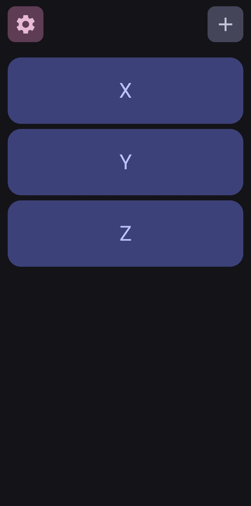

<!-- PROJECT SHIELDS -->
[![Contributors][contributors-shield]][contributors-url]
[![Forks][forks-shield]][forks-url]
[![Stargazers][stars-shield]][stars-url]
[![Issues][issues-shield]][issues-url]
[![Unlicense License][license-shield]][license-url]

<!-- PROJECT LOGO -->
 

    
    <h3 align="center">Just Loyalty Cards</h3>
    

        Just a simple app for keeping your store cards (or any images).
         
        <a href="https://github.com/KarelCerny404/JustLoyaltyCards/releases/tag/v1.0.0"><strong>Download</strong></a>
    

<!-- TABLE OF CONTENTS -->

  
Table of Contents

  <ol>
    <li>
      <a href="#about-the-project">About The Project</a>
      <ul>
        <li><a href="#built-with">Built With</a></li>
      </ul>
    <li><a href="#contributing">Contributing</a></li>
    <li><a href="#license">License</a></li>
    <li><a href="#contact">Contact</a></li>
    <li><a href="#acknowledgments">Acknowledgments</a></li>
  </ol>

<!-- ABOUT THE PROJECT -->

## About The Project

There are many apps like this available; however, I didn't find one that really suited my needs so I
created this one.

Here's why:

* I couldn't find an app so simple that would just do the thing I want it to do without any extra
  stuff
* Other apps had ads and popup windows
* I wanted to be able to add cards even offline unlike apps that require connection for any reasons

(<a href="#readme-top">back to top</a>)

### Built With

* [![Compose][Compose-shield]][Compose-url]
* [![Kotlin][Kotlin-shield]][Kotlin-url]
* [![Material Design][Material-shield]][Material-url]

(<a href="#readme-top">back to top</a>)
****

<!-- CONTRIBUTING -->

## Contributing

Contributions are what make the open source community such an amazing place to learn, inspire, and
create. Any contributions you make are **greatly appreciated**.

If you have a suggestion that would make this better, please fork the repo and create a pull
request. You can also simply open an issue with the tag "enhancement". Don't forget to give the
project a star! Thanks again!

1. Fork the Project
2. Create your Feature Branch (`git checkout -b feature/AmazingFeature`)
3. Commit your Changes (`git commit -m 'Add some AmazingFeature'`)
4. Push to the Branch (`git push origin feature/AmazingFeature`)
5. Open a Pull Request

(<a href="#readme-top">back to top</a>)

<!-- LICENSE -->

## License

Distributed under the MIT License. See `LICENSE.txt` for more information.

(<a href="#readme-top">back to top</a>)

<!-- CONTACT -->

## Contact

Karel Černý - [KarelCerny404](https://github.com/KarelCerny404)

Project
Link: [https://github.com/KarelCerny404/JustLoyaltyCards](https://github.com/KarelCerny404/JustLoyaltyCards)

(<a href="#readme-top">back to top</a>)

<!-- ACKNOWLEDGMENTS -->

## Acknowledgments

* [Choose an Open Source License](https://choosealicense.com)
* [Img Shields](https://shields.io)
* [Android Developer](https://developer.android.com/)

(<a href="#readme-top">back to top</a>)

[contributors-shield]: https://img.shields.io/github/contributors/KarelCerny404/JustLoyalCards.svg?style=for-the-badge
[contributors-url]: https://github.com/KarelCerny404/JustLoyalCards/graphs/contributors
[forks-shield]: https://img.shields.io/github/forks/KarelCerny404/JustLoyaltyCards.svg?style=for-the-badge
[forks-url]: https://github.com/KarelCerny404/JustLoyaltyCards/network/members
[stars-shield]: https://img.shields.io/github/stars/KarelCerny404/JustLoyaltyCards.svg?style=for-the-badge
[stars-url]: https://github.com/KarelCerny404/JustLoyaltyCards/stargazers
[issues-shield]: https://img.shields.io/github/issues/KarelCerny404/JustLoyaltyCards.svg?style=for-the-badge
[issues-url]: https://github.com/KarelCerny404/JustLoyaltyCards/issues
[license-shield]: https://img.shields.io/github/license/KarelCerny404/JustLoyaltyCards.svg?style=for-the-badge
[license-url]: https://github.com/KarelCerny404/JustLoyaltyCards/blob/master/LICENSE.txt
[product-screenshot]: img/screenshot.png
[Compose-shield]: https://img.shields.io/badge/Jetpack%20Compose-20232A?style=for-the-badge&logo=jetpackcompose
[Compose-url]: https://developer.android.com/compose
[Kotlin-shield]: https://img.shields.io/badge/Kotlin-19191c?style=for-the-badge&logo=kotlin
[Kotlin-url]: https://kotlinlang.org/
[Material-shield]: https://img.shields.io/badge/Material%20Design-2B2B2B?style=for-the-badge&logo=material-design
[Material-url]: https://material.io/